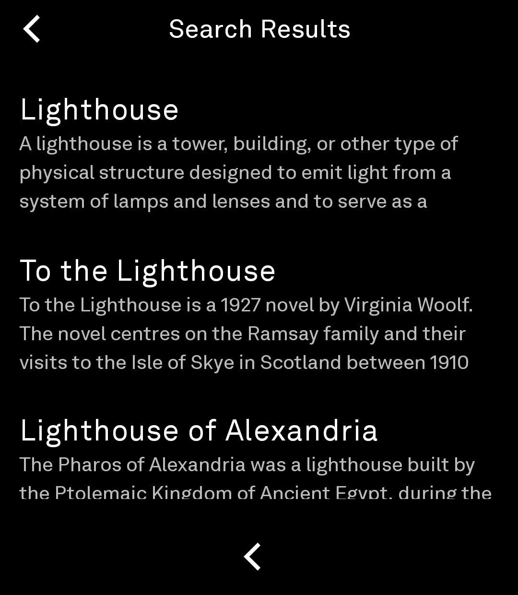
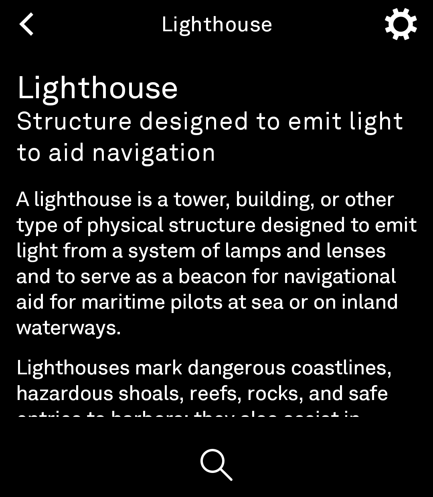
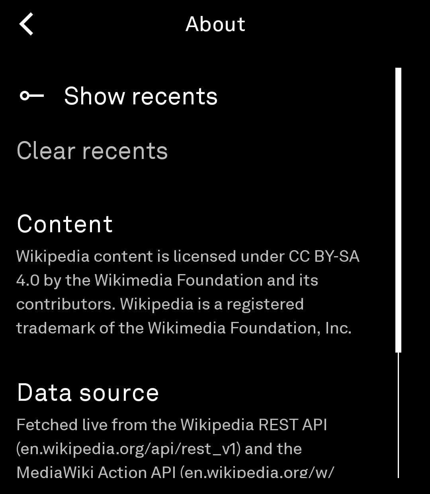
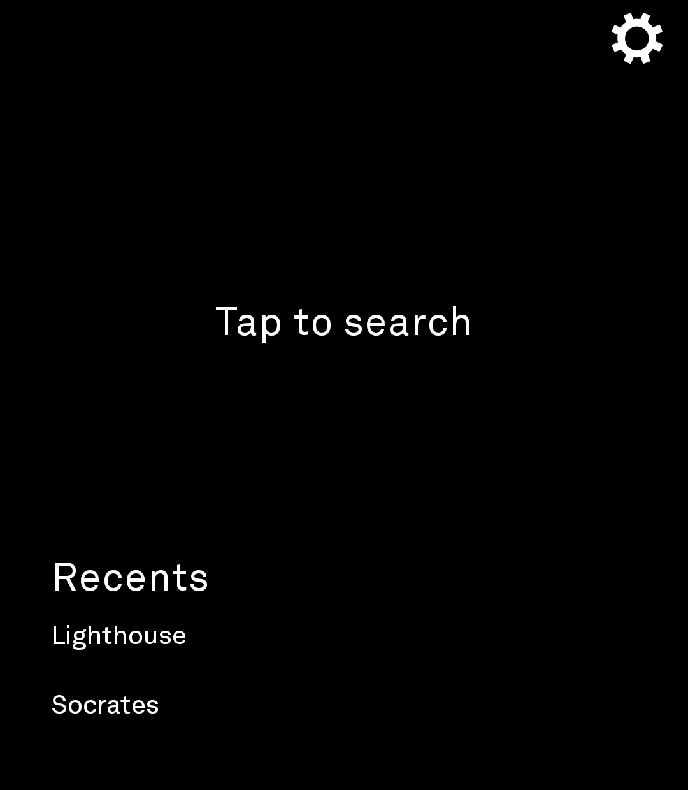

# Wikipedia Light for Light Phone III

A calm, text-first Wikipedia reader for the Light Phone III, built with the
[Light SDK](https://github.com/lightphone/light-sdk). The **Light** variant of
the Wikipedia tool: search articles, keep a short recents list, and read —
nothing else. No Random Article, no On This Day — all in LightOS's monochrome,
distraction-free style.

This is a fork of the Light SDK repo; all tool code lives in the `tool/`
module, which is what Light's build pipeline compiles
(`./gradlew :tool:assembleRelease`).

## Status

**Early community tool — not yet Light-vetted.** As of the Light SDK's July 2026
update, there's no "easy" share path yet; Light is building the pipeline to
sign and distribute community tools. Until then, you can **sideload the debug
APK** onto a Light Phone III via ADB (Light's own docs say that's fine for the
adventurous). LightOS will warn that the tool isn't vetted — that's expected.

## What this tool does

- **Search** — look up any Wikipedia article.
- **Recents** — your last few opened articles, collapsed under a single
  "Recents" label in the bottom-left; tap it to expand the list, one tap to
  reopen (toggleable in About — turning it off hides the section entirely).
- **Article view** — readable plain-text extract with section navigation
  and the full list of related articles, each tappable.
- **Haptics** — taps give a small vibration, following the phone's system
  haptic setting.

## Settings

Accessed via the gear icon on the home screen. Toggle Show recents on or off;
clear your recent articles list. The About page carries full attribution
(content license, data source, tool).

## Screenshots

Captured on a Light Phone III running the current build:

| Home | Search | Article |
|---|---|---|
|  |  |  |

| About | Recents |
|---|---|
|  |  |

## What this tool deliberately does not do

- No accounts, no tracking, no ads.
- No infinite feeds, recommendations, or "discover" surfaces — just the
  encyclopedia, the way LightOS intends tools to behave.

## Building & sideloading

You'll need Android Studio / the Android SDK and a GitHub token with package
read access (the SDK pulls a dependency from GitHub Packages — see the Light
SDK scaffold README's "Grabbing a token" step). Then, from the repo root:

```bash
./gradlew :tool:assembleDebug
```

The APK lands at `tool/build/outputs/apk/debug/tool-debug.apk`. With Developer
Options + USB debugging enabled on your Light Phone III:

```bash
adb install -r tool/build/outputs/apk/debug/tool-debug.apk
```

In LightOS, allow the tool under tool settings ("Any tools" / sideload) — it'll
warn that this one isn't Light-vetted yet, which is expected for a community
build.

`tool/lighttool.toml` targets real LightOS (`serverPackage = "com.lightos"`).
To run against the LightOS emulator instead, switch that line to
`com.thelightphone.sdk.emulator`.

## Notes

- Requires `android.permission.INTERNET` (Wikipedia REST + Action APIs).
- Article text and metadata come from the Wikimedia APIs; content is licensed
  under [CC BY-SA](https://creativecommons.org/licenses/by-sa/4.0/). The app's
  About screen credits this.

## License

MIT — see the repository [LICENSE](../../LICENSE).
